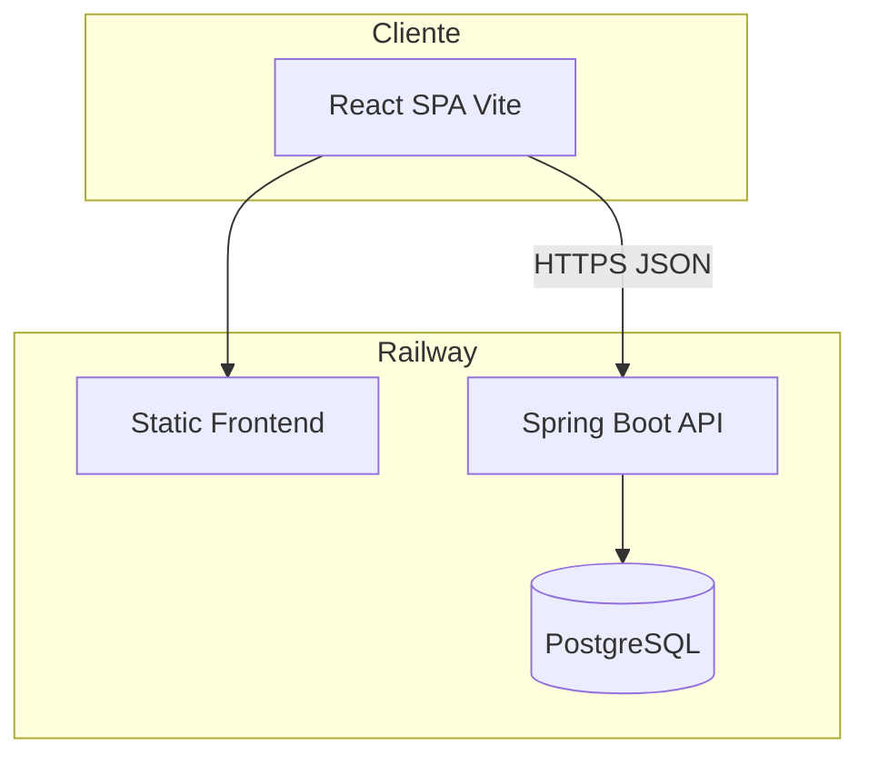

# Arquitetura VOA

## Estilo

**Modular monolith** Spring Boot: um deployável, módulos Java por pacote/bounded context, banco PostgreSQL único, fronteira clara para eventual extração de serviços (pagamentos, notificações).



## Módulos backend (`br.jlturismo.voa.modules.*`)

| Módulo | Responsabilidade |
|--------|------------------|
| `core` | Config, exceções globais, health, feature flags |
| `auth` | Login, refresh, RBAC, usuários |
| `solicitacoes` | Pedidos de viagem, status, anexos leves |
| `cotacoes` | Versões de cotação, itens, validade |
| `vendas` | Conversão cotação→venda, totais, responsável |
| `pagamentos` | Registro de pagamentos/parcelas, conciliação manual |
| `bilhetes` | Metadados + storage refs (S3/Railway volume futuro) |
| `audit` | Eventos append-only, consulta filtrada |

Comunicação **in-process** via serviços de aplicação; **sem** chamadas HTTP internas no MVP. Eventos de domínio via `ApplicationEventPublisher` ou outbox table (fase 4+) para integrações.

## Camadas por módulo

```
module/
├── api/          # @RestController, DTO request/response
├── application/  # casos de uso, transações
├── domain/       # entidades, enums, regras puras
└── infrastructure/ # JPA repos, adapters
```

## Frontend

```
frontend/src/
├── app/              # router, providers, layout shell
├── features/
│   ├── auth/
│   ├── solicitacoes/
│   ├── cotacoes/
│   ├── vendas/
│   ├── pagamentos/
│   ├── bilhetes/
│   └── admin/
└── shared/
    ├── ui/           # Button, Table, Modal… (design system VOA)
    ├── theme/        # tokens.css inspirados OpenCode + JL
    ├── api/          # client axios/fetch + interceptors refresh
    └── lib/
```

- **Mobile-first** (375px); listagens com padrão tabela→cards.
- Estado servidor: TanStack Query; formulários: React Hook Form + Zod.

## Integrações (futuro, interfaces no monolith)

| Integração | MVP | Notas |
|------------|-----|-------|
| GDS / consolidador | ❌ | Manual entry |
| Gateway pagamento | Stub | Webhook adapter em `pagamentos` |
| E-mail transacional | Opcional Etapa 4 | SendGrid/similar |
| Storage arquivos | Etapa 4 | Bilhetes PDF |

## Observabilidade

- Spring Actuator: `/actuator/health`, `/actuator/info` (protegidos).
- Logs estruturados JSON; correlation id por request.
- Métricas Railway nativas; sem APM obrigatório no MVP.

## Qualidade

- Backend: JUnit 5, Testcontainers Postgres em CI.
- Frontend: Vitest + Testing Library smoke.
- Contrato API: OpenAPI gerado (`springdoc-openapi`).

## Segurança transversal

Ver `docs/security.md`. Filtro JWT global; `@PreAuthorize` por role; auditoria em mutações de venda/pagamento/usuário.
