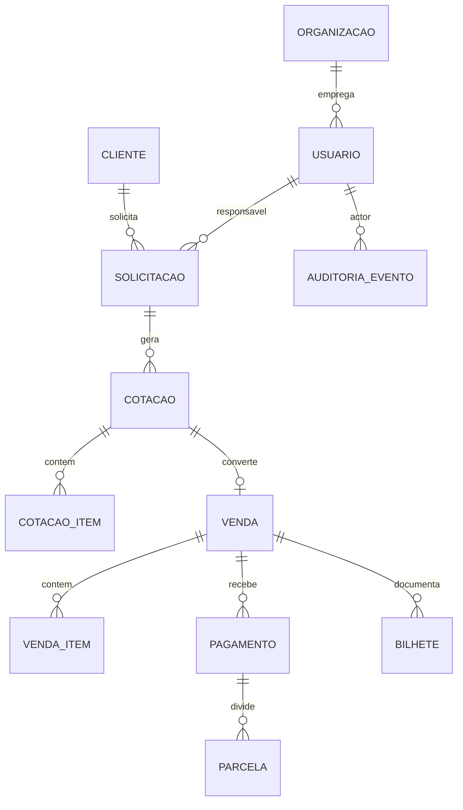

# Modelo de dados inicial (ERD)

Premissa: **single tenant** JL Turismo. Todas as tabelas principais podem incluir `organizacao_id` para evolução multi-tenant.

## Diagrama entidade-relacionamento (nível conceitual)

## Entidades principais

### Organização e identidade

| Entidade | Campos chave | Notas |
|----------|--------------|-------|
| `organizacao` | id, razao_social, cnpj, timezone | Seed JL Turismo |
| `usuario` | id, org_id, email, senha_hash, nome, ativo | Unique (org, email) |
| `usuario_papel` | usuario_id, papel | ENUM: ADMIN, COMERCIAL, OPERACOES, FINANCEIRO, AUDITOR |
| `refresh_token` | id, usuario_id, token_hash, expira_em, revogado | ADR-002 |

### CRM leve

| Entidade | Campos chave | Notas |
|----------|--------------|-------|
| `cliente` | id, org_id, nome, email, telefone, documento | PF/PJ simplificado |

### Fluxo comercial

| Entidade | Campos chave | Notas |
|----------|--------------|-------|
| `solicitacao` | id, org_id, cliente_id, titulo, destino, datas_previstas, status, criado_por | Status: RASCUNHO, EM_COTACAO, FECHADA, CANCELADA |
| `cotacao` | id, solicitacao_id, versao, validade, status, total_bruto, observacoes | Status: RASCUNHO, ENVIADA, ACEITA, RECUSADA, EXPIRADA |
| `cotacao_item` | id, cotacao_id, tipo, descricao, quantidade, valor_unitario, moeda | tipo: AEREO, HOTEL, SERVICO, OUTRO |
| `venda` | id, cotacao_id, codigo, status, total, vendedor_id, fechada_em | Status: ABERTA, CONFIRMADA, CANCELADA |
| `venda_item` | id, venda_id, snapshot de cotacao_item | Desnormalizado pós-fechamento |

### Financeiro

| Entidade | Campos chave | Notas |
|----------|--------------|-------|
| `pagamento` | id, venda_id, forma, valor_total, status | Status: PENDENTE, PARCIAL, QUITADO, ESTORNADO |
| `parcela` | id, pagamento_id, numero, vencimento, valor, pago_em | Conciliação manual MVP |

### Bilhetes e arquivos

| Entidade | Campos chave | Notas |
|----------|--------------|-------|
| `bilhete` | id, venda_id, tipo, localizador, emissor, arquivo_url, metadados_json | Sem GDS |
| `anexo` | id, entidade_tipo, entidade_id, url, mime | Genérico |

### Comissão (placeholder ADR-003)

| Entidade | Campos chave | Notas |
|----------|--------------|-------|
| `comissao_regra` | id, org_id, percentual, base_calculo, ativo | `ativo=false` no seed |
| `venda_comissao` | venda_id, percentual_aplicado, valor_calculado | Nullable; sem trigger de cálculo |

### Auditoria

| Entidade | Campos chave | Notas |
|----------|--------------|-------|
| `auditoria_evento` | id, org_id, actor_id, acao, entidade_tipo, entidade_id, payload_json, ip, criado_em | Append-only |

## Índices recomendados

- `solicitacao(org_id, status, criado_em DESC)`
- `cotacao(solicitacao_id, versao DESC)`
- `venda(org_id, codigo UNIQUE)`
- `auditoria_evento(org_id, criado_em DESC)`
- `cliente(org_id, documento)` where documento not null

## Estratégia Flyway

| Prática | Detalhe |
|---------|---------|
| Localização | `backend/src/main/resources/db/migration/` |
| Naming | `V{version}__{descricao_snake}.sql` — ex.: `V1__core_organizacao_usuario.sql` |
| Ordem sugerida | V1 core+auth → V2 clientes+solicitacoes → V3 cotacoes → V4 vendas → V5 pagamentos → V6 bilhetes → V7 audit → V8 comissao_placeholder |
| Seed | `R__seed_jl_turismo.sql` repeatable ou `V1` com admin inicial via env |
| Rollback | **Forward-only**; correções via nova migration |
| CI | Flyway validate + Testcontainers migrate on build |
| Prod Railway | `spring.flyway.enabled=true`; backup Postgres antes de major |

## Tipos e convenções

- PK: `UUID` (v7 preferível Java 21) ou `BIGSERIAL` — **decisão Etapa 2:** UUID para IDs expostos em API.
- Dinheiro: `NUMERIC(19,4)` + moeda ISO 4217 char(3).
- Timestamps: `TIMESTAMPTZ` UTC; converter na API para America/Sao_Paulo quando exibir.
- Soft delete: apenas `cliente` e `usuario` (`deleted_at`); vendas **nunca** hard delete.
