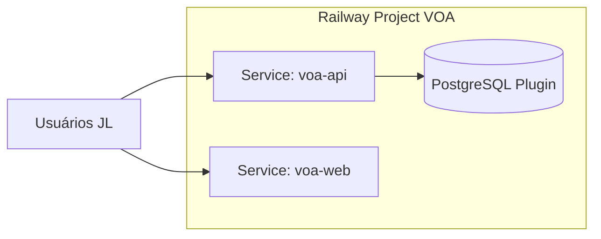

# Deploy Railway

Referência operacional: GuiaDeCorrida usa `railway.toml` na raiz com build Node — **VOA usa projeto Railway separado** (ADR-001).

## Topologia recomendada



| Serviço | Root directory | Build | Start |
|---------|----------------|-------|-------|
| `voa-api` | `/backend` | `./mvnw -DskipTests package` ou Nixpacks Java | `java -jar target/voa-*.jar` |
| `voa-web` | `/frontend` | `npm ci && npm run build` | Static (`npx serve dist` ou Caddy) |
| Postgres | Plugin | — | `DATABASE_URL` injetado |

## Domínios e CORS

- Opção A: `app.voa.jl...` (static) + `api.voa.jl...` (API) — CORS explícito + cookies `Domain=.jl...`.
- Opção B (MVP rápido): API faz proxy de `/` para static (single service) — simplifica cookies, perde deploy independente.

**Recomendação Etapa 2:** Opção B single service; migrar para A na Etapa 4 se tráfego exigir.

## Variáveis de ambiente (API)

| Variável | Obrigatória | Descrição |
|----------|-------------|-----------|
| `DATABASE_URL` | Sim | JDBC Postgres (Railway) |
| `SPRING_PROFILES_ACTIVE` | Sim | `prod` |
| `JWT_ACCESS_SECRET` ou key pair | Sim | Assinatura access token |
| `JWT_ACCESS_TTL_MINUTES` | Não | Default 15 |
| `JWT_REFRESH_TTL_DAYS` | Não | Default 7 |
| `VOA_CORS_ORIGINS` | Se split FE | Lista separada por vírgula |
| `VOA_SEED_ADMIN_EMAIL` | Bootstrap | Primeiro admin (só se DB vazio) |
| `VOA_SEED_ADMIN_PASSWORD` | Bootstrap | One-time; rotacionar |
| `COMISSAO_AUTO_ENABLED` | Não | `false` (ADR-003) |
| `TZ` | Não | `America/Sao_Paulo` |

## Variáveis (frontend build)

| Variável | Descrição |
|----------|-----------|
| `VITE_API_BASE_URL` | URL pública da API |

## `railway.toml` (esboço backend)

```toml
[build]
builder = "NIXPACKS"
buildCommand = "./mvnw -DskipTests package"

[deploy]
startCommand = "java -Dserver.port=$PORT -jar target/voa-*.jar"
healthcheckPath = "/actuator/health"
restartPolicyType = "ON_FAILURE"
```

## Flyway em produção

- Migrate on startup (`spring.flyway.baseline-on-migrate=false`).
- Backup manual Postgres antes de releases com migration destrutiva.
- Nunca editar migration já aplicada.

## CI/CD

- GitHub Actions: test + build on PR; push `main` → Railway auto-deploy (webhook).
- Sem deploy de GuiaDeCorrida a partir do repo VOA.

## Automação Railway via MCP

**Etapa 0:** não há namespace MCP `railway` no ambiente Cloud Agent. Automação existente no workspace atual limita-se a:

- `railway.toml` do **GuiaDeCorrida** (API Node).
- `guia-mcp-server/railway.toml` (serviço MCP editorial).
- Documentação operacional em `docs/` do Guia (variáveis, PEM Apple, etc.).

Provisionamento VOA: **manual** no dashboard Railway ou CLI local (`railway link`) — **não criar recursos pagos** nesta etapa.

## Observabilidade Railway

- Logs agregados por serviço; alertas via Railway notifications (configurar na Etapa 2).
- Healthcheck falha → restart conforme policy.
