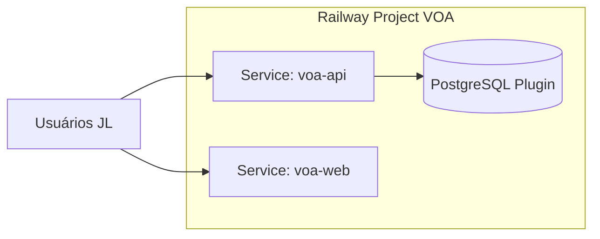

# Deploy Railway

Referência operacional: GuiaDeCorrida usa `railway.toml` na raiz com build Node — **VOA usa projeto Railway separado** (ADR-001).

## Topologia recomendada



| Serviço | Root directory | Build | Start |
|---------|----------------|-------|-------|
| `voa-api` | `/backend` | `./mvnw -DskipTests package` ou Nixpacks Java | `java -jar target/voa-*.jar` |
| `voa-web` | `/frontend` | `npm ci && npm run build` | Static (`npx serve dist` ou Caddy) |
| Postgres | Plugin | — | `DATABASE_URL` injetado |

## Domínios e CORS

- Opção A: `app.voa.jl...` (static) + `api.voa.jl...` (API) — CORS explícito + cookies `Domain=.jl...`.
- Opção B (MVP rápido): API faz proxy de `/` para static (single service) — simplifica cookies, perde deploy independente.

**Recomendação Etapa 2:** Opção B single service; migrar para A na Etapa 4 se tráfego exigir.

## Variáveis de ambiente (API)

| Variável | Obrigatória | Descrição |
|----------|-------------|-----------|
| `DATABASE_URL` | Sim | JDBC Postgres (Railway) |
| `SPRING_PROFILES_ACTIVE` | Sim | `prod` |
| `JWT_ACCESS_SECRET` ou key pair | Sim | Assinatura access token |
| `JWT_ACCESS_TTL_MINUTES` | Não | Default 15 |
| `JWT_REFRESH_TTL_DAYS` | Não | Default 7 |
| `VOA_CORS_ORIGINS` | Se split FE | Lista separada por vírgula |
| `VOA_SEED_ADMIN_EMAIL` | Bootstrap | Primeiro admin (só se DB vazio) |
| `VOA_SEED_ADMIN_PASSWORD` | Bootstrap | One-time; rotacionar |
| `COMISSAO_AUTO_ENABLED` | Não | `false` (ADR-003) |
| `TZ` | Não | `America/Sao_Paulo` |

## Variáveis (frontend build)

| Variável | Descrição |
|----------|-----------|
| `VITE_API_BASE_URL` | URL pública da API |

## `railway.toml` (esboço backend)

```toml
[build]
builder = "NIXPACKS"
buildCommand = "./mvnw -DskipTests package"

[deploy]
startCommand = "java -Dserver.port=$PORT -jar target/voa-*.jar"
healthcheckPath = "/actuator/health"
restartPolicyType = "ON_FAILURE"
```

## Flyway em produção

- Migrate on startup (`spring.flyway.baseline-on-migrate=false`).
- Backup manual Postgres antes de releases com migration destrutiva.
- Nunca editar migration já aplicada.

## CI/CD

- GitHub Actions: test + build on PR; push `main` → Railway auto-deploy (webhook).
- Sem deploy de GuiaDeCorrida a partir do repo VOA.

## Automação Railway via MCP

**Etapa 0:** não há namespace MCP `railway` no ambiente Cloud Agent. Automação existente no workspace atual limita-se a:

- `railway.toml` do **GuiaDeCorrida** (API Node).
- `guia-mcp-server/railway.toml` (serviço MCP editorial).
- Documentação operacional em `docs/` do Guia (variáveis, PEM Apple, etc.).

Provisionamento VOA: **manual** no dashboard Railway ou CLI local (`railway link`) — **não criar recursos pagos** nesta etapa.

## Etapa L — deploy passo a passo (Railway, sem criar cobrança extra)

Checklist operacional para a JL Turismo subir staging/produção **sem** abrir serviços pagos além do que a equipe já aprovou (Postgres plugin + compute do plano escolhido).

### 1. Preparar repositório

1. Confirmar que o remoto aponta para o repo VOA (`85ED/voa`), branch `main`.
2. Garantir CI verde: `./mvnw -f backend test` e `npm --prefix frontend test -- --run && npm --prefix frontend run build`.
3. Não versionar segredos; usar apenas variáveis Railway.

### 2. Criar projeto Railway (dashboard)

1. Acesse [railway.app](https://railway.app) com a conta JL.
2. **New Project** → **Deploy from GitHub repo** → selecione `voa`.
3. **Não** adicionar templates pagos de terceiros; apenas o repositório e o plugin Postgres abaixo.

### 3. Plugin PostgreSQL

1. No project VOA: **Add service** → **Database** → **PostgreSQL**.
2. Copie `DATABASE_URL` (ou referência `${{Postgres.DATABASE_URL}}`) para o serviço API.
3. Antes da primeira release com migration destrutiva: **Backups** → snapshot manual.

### 4. Serviço API (`voa-api`)

1. **Add service** → mesmo repo → root directory **`/backend`** (ou monorepo com build command na raiz apontando para backend).
2. Build command: `./mvnw -DskipTests package`
3. Start command: `java -Dserver.port=$PORT -jar target/voa-*.jar`
4. Healthcheck path: `/actuator/health`
5. Variáveis (mínimo):

| Variável | Valor exemplo |
|----------|----------------|
| `SPRING_PROFILES_ACTIVE` | `prod` |
| `DATABASE_URL` | `${{Postgres.DATABASE_URL}}` |
| `JWT_ACCESS_SECRET` | string aleatória ≥ 32 chars |
| `VOA_SEED_ADMIN_EMAIL` | e-mail bootstrap (só DB vazio) |
| `VOA_SEED_ADMIN_PASSWORD` | senha forte one-time |
| `COMISSAO_AUTO_ENABLED` | `false` |
| `VOA_CORS_ORIGINS` | URL do frontend (se split) |
| `VOA_PUBLIC_RATE_LIMIT_PER_MINUTE` | `30` |
| `VOA_PUBLIC_POST_RATE_LIMIT_PER_MINUTE` | `8` |
| `VOA_LOGIN_RATE_LIMIT_PER_MINUTE` | `20` |
| `PUBLIC_BASE_URL` | URL pública do SPA (links `/p/{slug}`) |
| `VOA_API_CONTENT_SECURITY_POLICY` | CSP resposta API (opcional) |

6. Deploy → aguardar logs `Flyway` + `Started VoaApplication`.

### 5. Serviço frontend (`voa-web`) — opção split

1. **Add service** → root **`/frontend`**.
2. Build: `npm ci && npm run build`
3. Start: `npx serve -s dist -l $PORT` (ou Caddy/nginx estático).
4. Build-time: `VITE_API_BASE_URL=https://<domínio-api>` e `PUBLIC_BASE_URL=https://<domínio-web>` no serviço API.

**Opção MVP single service:** servir `frontend/dist` pelo Spring (recurso estático) — uma única URL simplifica cookies; migrar para split quando tráfego exigir.

### 6.1 Rollback

1. Railway → serviço API → **Deployments** → redeploy da imagem/commit anterior estável.
2. Se migration Flyway irreversível: restaurar snapshot Postgres (passo 3) **antes** de redeploy antigo.
3. Validar `GET /actuator/health` e smoke login após rollback.

### 6. Domínios e HTTPS

1. Em cada serviço: **Settings** → **Networking** → **Generate domain** (`.up.railway.app`) ou CNAME corporativo.
2. Se API e web em hosts diferentes: configurar `VOA_CORS_ORIGINS` e cookies `VOA_COOKIE_SECURE=true`.

### 7. Webhook GitHub → auto-deploy

1. Railway service → **Settings** → conectar branch `main`.
2. GitHub Actions (`.github/workflows`) já valida PR; push em `main` dispara deploy Railway.

### 8. Pós-deploy

1. `GET https://<api>/actuator/health` → `UP`.
2. Login admin seed; rotacionar senha bootstrap.
3. Smoke: landing pública `/`, `GET /api/v1/public/promocoes`, fluxo autenticado painel.
4. Monitorar logs; configurar alertas Railway (opcional, sem custo extra de MCP).

### 9. O que **não** fazer nesta etapa

- Não provisionar Redis, S3 pago ou add-ons não listados no escopo MVP.
- Não editar migrations já aplicadas em produção.
- Não habilitar `COMISSAO_AUTO_ENABLED` até ADR-003 desbloqueado pela JL.

## Observabilidade Railway

- Logs agregados por serviço; alertas via Railway notifications (configurar na Etapa 2).
- Healthcheck falha → restart conforme policy.
