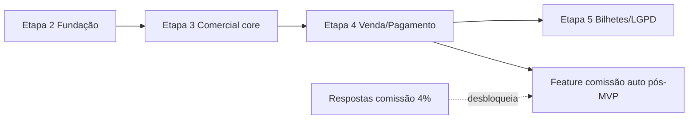

# Plano de implementação (Etapas 2–5)

## Divisão em 5 papéis de agente (spec)

| Papel | Escopo principal | Entregáveis |
|-------|------------------|-------------|
| **A — Plataforma & DevOps** | Repo, CI, Railway, Flyway, Actuator, feature flags | Monorepo VOA, pipeline, deploy staging |
| **B — Core & Auth** | Usuários, RBAC, JWT/refresh, clientes, auditoria base | Módulos `auth`, `core`, `audit`, OpenAPI auth |
| **C — Comercial** | Solicitações, cotações, conversão venda | Módulos `solicitacoes`, `cotacoes`, `vendas` + telas |
| **D — Financeiro & Bilhetes** | Pagamentos, parcelas, bilhetes/anexos | Módulos `pagamentos`, `bilhetes` + telas |
| **E — Frontend & UX** | Design system, shell, integração API, mobile | `shared/ui`, layout, TanStack Query, tokens JL/OpenCode |

Agentes **B/C/D** dependem de **A** (Etapa 2) e **B** (auth). **E** paraleliza após contratos OpenAPI stub.

## Etapa 2 — Fundação

**Objetivo:** repo VOA deployável vazio com Postgres e health.

| Tarefa | Papel | Depende de |
|--------|-------|------------|
| Criar repo Git + README + `.gitignore` | A | ADR-001 |
| Spring Boot skeleton + profiles local/prod | A | — |
| Flyway V1 (organizacao, usuario, refresh_token) | A, B | — |
| Docker Compose Postgres dev | A | — |
| GitHub Actions (test + package) | A | — |
| Railway project staging (manual) | A | credenciais JL |
| Frontend Vite shell + login placeholder | E | API health |
| OpenAPI springdoc habilitado | B | skeleton |

**Critérios de aceite Etapa 2**

- [ ] `GET /actuator/health` = UP com Postgres Railway/dev.
- [ ] Flyway migrate clean do zero.
- [ ] Login retorna 401 sem credenciais; seed admin funciona via env.
- [ ] SPA build servida (single service ou static service).
- [ ] Nenhum arquivo alterado em GuiaDeCorrida.

## Etapa 3 — Núcleo operacional

**Objetivo:** solicitações + cotações + clientes + auditoria consultável.

| Tarefa | Papel |
|--------|-------|
| CRUD clientes + busca | B |
| Fluxo solicitação (status) | C |
| Cotação versionada + itens | C |
| Auditoria automática em mutações | B |
| Telas listagem/detalhe mobile-first | E |

**Critérios de aceite Etapa 3**

- [ ] Comercial cria solicitação → cotação v1 → enviar/aceitar.
- [ ] AUDITOR lê `/audit/eventos` filtrado.
- [ ] Testes integração Testcontainers ≥ fluxo feliz solicitação.

## Etapa 4 — Venda e pagamento

**Objetivo:** fechar venda e registrar pagamentos (sem gateway).

| Tarefa | Papel |
|--------|-------|
| POST converter cotação → venda idempotente | C |
| Confirmar/cancelar venda | C |
| Pagamentos + parcelas + status | D |
| Tela financeiro + resumo venda | E, D |
| Flag comissão desligada + campo manual opcional | C, D (ADR-003) |

**Critérios de aceite Etapa 4**

- [ ] Venda CONFIRMADA só de cotação ACEITA.
- [ ] Pagamento PARCIAL/QUITADO reflete parcelas.
- [ ] Idempotency-Key evita venda duplicada.
- [ ] Zero código calculando 4% automático.

## Etapa 5 — Bilhetes, hardening, LGPD mínimo

**Objetivo:** documentos de viagem + segurança produção.

| Tarefa | Papel |
|--------|-------|
| CRUD bilhete + upload (volume ou S3) | D |
| Rate limit login; CSP | B |
| Export dados cliente (admin) | B |
| Relatório vendas CSV | C |
| Split deploy FE/API se necessário | A |
| Documentação runbook JL | A |

**Critérios de aceite Etapa 5**

- [ ] Bilhete associado à venda com arquivo recuperável autenticado.
- [ ] Pentest checklist interno (OWASP ASVS L1 parcial).
- [ ] Runbook backup/restore Postgres testado.

## Dependências entre etapas

## Perguntas comerciais

### Bloqueantes (impedem regra automática de comissão e alguns relatórios financeiros)

1. Base de cálculo do **4%** (bruto/líquido/margem/total cliente).
2. Incidência uniforme vs por tipo de produto/fornecedor.
3. Tratamento de taxas (DU, RAV, fees) na base.
4. Split comissão agência vs vendedor.
5. Momento de reconhecimento (venda vs pagamento vs emissão).
6. Política de estorno/cancelamento.
7. Exceções contratuais por cliente corporativo.

### Premissas seguras para iniciar fundação (Etapas 2–3)

- Single tenant JL Turismo; BRL; fluxo solicitação→cotação manual.
- Comissão apenas campo manual / vazio; `COMISSAO_AUTO_ENABLED=false`.
- Pagamentos registrados manualmente; sem gateway.
- Bilhetes metadados + upload; sem GDS.
- RBAC fixo cinco papéis; sem SSO no MVP.
- Identidade visual: tokens OpenCode adaptados até brand book JL.

## Riscos técnicos

| Risco | Impacto | Mitigação |
|-------|---------|-----------|
| Workspace errado (Guia vs VOA) | Commit/de deploy incorreto | ADR-001; clone dedicado Etapa 2 |
| Cookies JWT cross-origin Railway | Login quebrado | Single service MVP ou domínio wildcard |
| Flyway drift entre dev/prod | Deploy falha | Validate CI; backup antes migrate |
| Scope creep GDS | Atraso | Out of scope explícito |
| LGPD sem DPA Railway | Compliance | DPA antes prod real |
| Comissão implementada cedo | Retrabalho financeiro | ADR-003 + feature flag |
| Agentes paralelos conflitando migrations | SQL clash | Owner papel A serializa Flyway |
| Mono-first UI ilegível em textos longos | UX | Plex Sans + Mono híbrido |
| Sem MCP Railway | Automação manual | CLI/dashboard; documentar runbook |

## Próximo passo imediato (pós Etapa 1)

1. JL Turismo confirma **repo remoto** (GitHub org) e acesso Railway.
2. Responder perguntas **bloqueantes** de comissão antes de Etapa 4 feature financeira avançada.
3. Agente **A** inicia Etapa 2 no clone VOA (não `/workspace` Guia).

---

## Status de implementação (atualizado)

Registro do que **já está no código** do monorepo VOA (`/home/ubuntu/voa`), não apenas planejado.

### Etapa 2 — Fundação (concluída)

- [x] Spring Boot 3.4 + Postgres + Flyway V1 (org/usuário/refresh) e V2 (clientes/solicitações).
- [x] Auth JWT cookie + CSRF + seed admin em testes.
- [x] Frontend Vite: login, shell, proxy API.
- [x] CI GitHub Actions (backend + frontend).
- [x] OpenAPI via springdoc nos controllers existentes.

### Etapa C — Cotações (concluída)

- [x] Flyway **V3** (`cotacao`, `cotacao_item`, `cotacao_alternativa`, `cotacao_evento`).
- [x] Módulo `cotacoes`: versões por solicitação, validade, itens, **alternativas de voo**, total de itens.
- [x] Transições: enviar / aceitar / recusar com `CotacaoStateMachine` + histórico (`cotacao_evento` + endpoint `/historico`).
- [x] REST conforme `docs/api.md` (rotas `/solicitacoes/{id}/cotacoes`, `/cotacoes/{id}/…`).
- [x] Testes: `CotacaoStateMachineTest` + fluxo em `ComercialFlowIntegrationTest`.

### Etapa D — Vendas + máquina de estados (concluída)

- [x] Flyway **V4** (`venda`, `venda_item`, `venda_idempotencia`).
- [x] Converter cotação **ACEITA** → venda **ABERTA** (header `Idempotency-Key`).
- [x] Venda **manual** (`POST /api/v1/vendas/manual`).
- [x] Confirmar / cancelar com `VendaStateMachine` (409 em transição inválida).
- [x] Testes: `VendaStateMachineTest` + integração comercial.

### Etapa E — Clientes / passageiros (concluída)

- [x] Cliente (V2) já existente; **passageiro** entidade separada Flyway **V5**.
- [x] Vínculos `solicitacao_passageiro` e `venda_passageiro` (cópia automática na conversão).
- [x] REST `/api/v1/passageiros` e `/api/v1/solicitacoes/{id}/passageiros`.

### Frontend agência (parcial)

- [x] Tela **Cotações** (`/cotacoes`): listar solicitações, criar cotação, alternativa de voo, enviar/aceitar/converter.
- [ ] Listagem/detalhe de solicitações e vendas no SPA (próximo).

### Próximo no roadmap (Etapas 4–5 do plano original)

| Área | Pendente |
|------|----------|
| **Pagamentos** | Flyway V5→V6, parcelas, status PARCIAL/QUITADO |
| **Bilhetes** | Metadados + upload, associação à venda |
| **Dashboard / relatórios** | KPIs comerciais, export CSV |
| **Auditoria** | Tabela `auditoria_evento` + `/audit/eventos` |
| **Financeiro UI** | Tela pagamentos pós-API |

